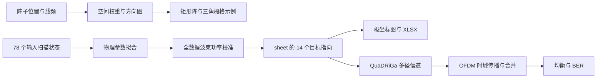
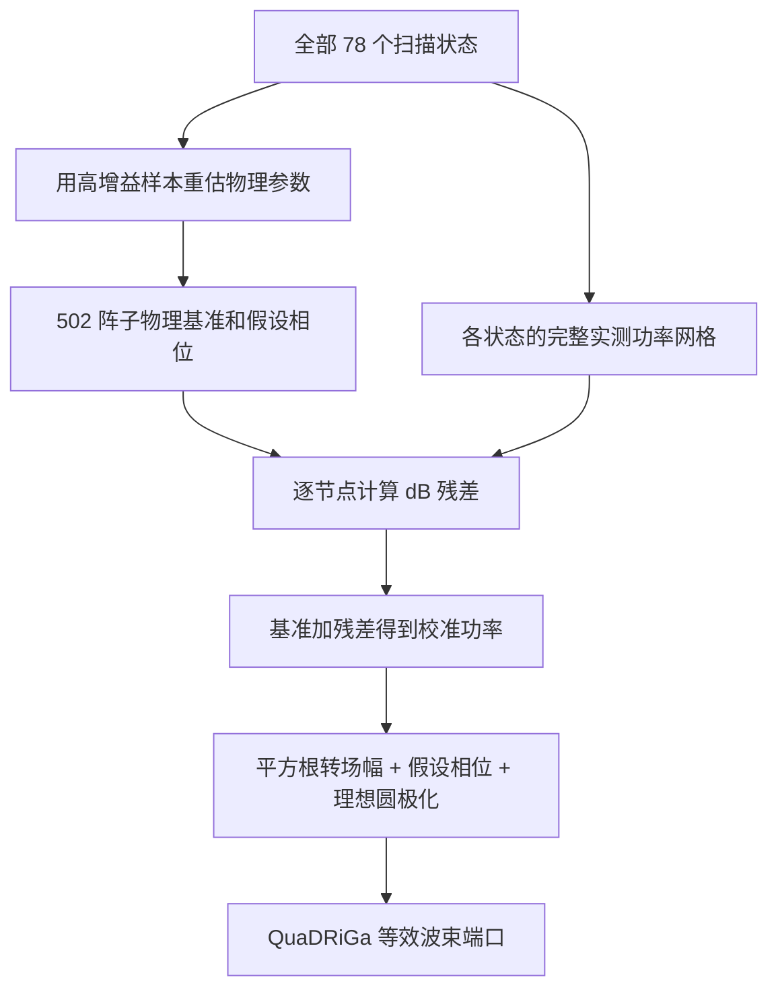
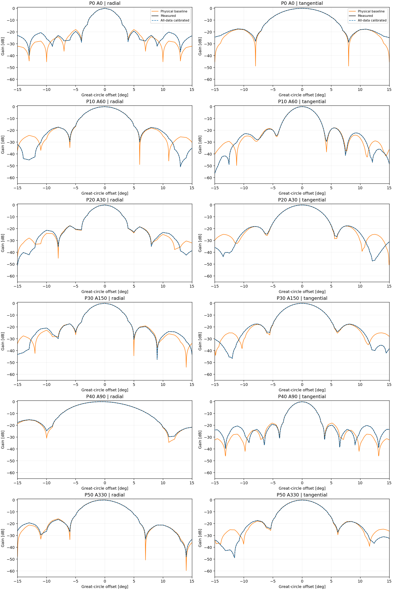
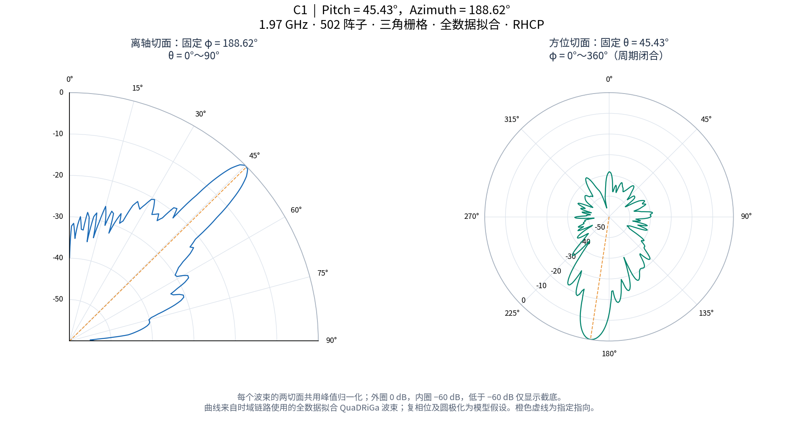
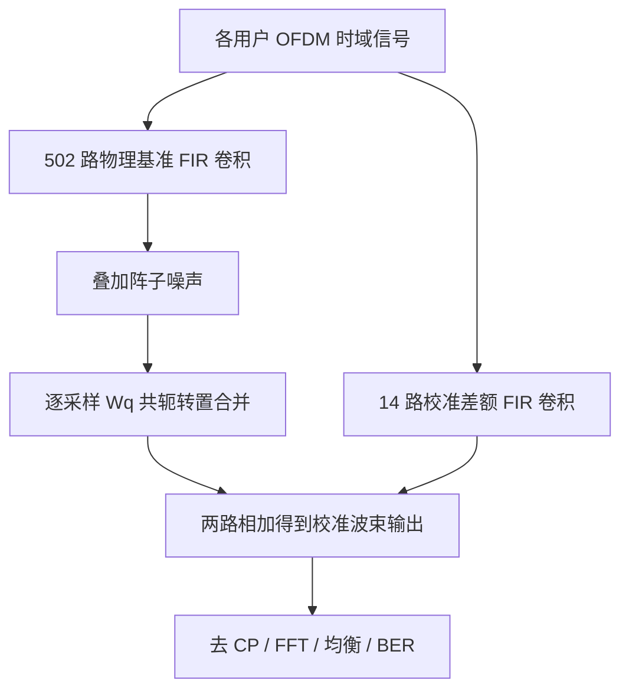

# 从波束到链路：项目入门 Handbook

这份手册面向第一次接触阵列天线或 QuaDRiGa 的读者。目标是先知道“正在模拟什么”，再知道“应该运行哪个文件”，最后能解释输出结果。可以先看已有图片和结果，不必一开始就重新拟合或运行完整链路。

本文对应当前代码：基础示例使用 **3.5 GHz、32×16 矩形阵**；实测数据相关模块使用 **1.97 GHz、502 阵子、椭圆裁剪三角栅格**。二者是不同配置，不要把缓存中的权重直接交叉使用。

## 学习路线

| 阶段 | 先回答的问题 | 本文位置 |
|---|---|---|
| 看懂项目 | 天线、波束、方向图和信道有什么区别？ | [1. 基本概念](#basics) |
| 做第一个仿真 | 怎样用相位权重让阵列朝某个方向接收？ | [2. 最小波束实验](#first-beam) |
| 理解阵列配置 | 矩形、三角栅格和圆极化改变了什么？ | [3. 阵列与极化](#arrays) |
| 读懂输入 | 78 个文件、14 个波束、θ/φ 分别是什么？ | [4. 数据与坐标](#coordinates) |
| 理解拟合 | 如何从少量物理参数走到全数据校准？ | [5. 实测数据拟合](#fitting) |
| 产生新波束 | 表格中的任意小数角度怎样使用测量数据？ | [6. sheet 波束](#sheet) |
| 使用方向图 | 如何看极坐标切面、导出完整 Excel？ | [7. 绘图与导出](#exports) |
| 进入通信链路 | 波束响应怎样变成信道、采样和 BER？ | [8. 频域链路](#frequency)、[9. 时域链路](#time) |
| 接入校准 | 全数据拟合的综合波束怎样参与时域传播？ | [10. 校准时域链路](#calibrated-link) |
| 动手学习 | 按什么顺序运行、怎样判断运行正确？ | [11. 操作路线](#practice)、[12. 结果与常见问题](#checks) |



<a id="basics"></a>
## 1. 先分清四个对象

### 1.1 阵子：空间里的接收点

一个阵子可以理解为一个接收电磁波的“小耳朵”。来自同一方向的波到达不同位置时，相位通常不同。阵列保存这些空间差异，给后续处理提供辨别方向的能力。

在代码中，位置通常写成 `p`，大小为 `3×N`：每一列是一个阵子的 `[x;y;z]` 坐标，单位为米。位置、载频和阵子端口顺序需要一致。

### 1.2 波束：怎样合并这些接收点

波束权重给每路信号乘一个复数，再求和。复数同时表达幅度和相位：把某个方向的相位对齐，该方向会相加增强；其他方向可能相互抵消。

```matlab
y = w' * r;  % N 路阵子信号 -> 1 路波束输出
```

这里 `r` 是 `N×1`，`w` 也是 `N×1`，MATLAB 的 `'` 表示**共轭转置**。如果要同时形成 14 个波束，就把 14 列权重并排组成 `W`，计算 `W' * r`。波束数量不等于阵子数量，也不等于已经部署了 14 副天线。

### 1.3 方向图：从各个方向来，接收得有多强

把入射方向逐个扫过去，记录合并后的响应，就得到方向图。它描述天线的空间选择性，通常展示主瓣、副瓣和零陷。

- 主瓣：主要接收方向，目标指向应位于这里。
- 副瓣：其他方向仍然能收到的响应，可能引入干扰。
- 零陷：相位抵消形成的低响应区域。

本项目输入数据是归一化功率 dB。`0 dB` 表示该图的参考峰值，`−20 dB` 表示功率为参考值的 1/100，**不表示绝对增益为 −20 dBi**。

功率和电场幅度的转换要区分：

```text
相对功率 = 10^(gain_db/10)
相对场幅 = 10^(gain_db/20)
```

### 1.4 信道：传播途中发生了什么

方向图描述天线；信道还包括传播距离、路径损耗、反射散射、多径时延、相位和极化耦合。同一天线放到不同环境、面对不同用户，会产生不同信道。

| 对象 | 回答的问题 | 本项目中的常见形式 |
|---|---|---|
| 阵列几何 | 阵子在哪里？ | `p`，`3×N` |
| 波束权重 | 接收信号如何合并？ | `Wq`，`N×14` |
| 功率方向图 | 各个角度的综合响应有多强？ | 每个波束一张 `91×360` 表 |
| 多径信道 | 各条传播路径的复系数和时延是什么？ | QuaDRiGa 的 `coeff`、`delay` |
| 离散时域信道 | 每个采样时刻如何卷积？ | `h_ant{u}`，`N×L` |
| 频域信道 | 每个子载波如何改变复符号？ | `Hf(:,:,u)` 或 `Heff(:,:,u)` |

因此，方向图表格不能直接充当完整的复数信道；它没有提供传播时延，也没有提供实测复相位。

<a id="first-beam"></a>
## 2. 第一个仿真：只看空间相加

先不引入用户、多径和 OFDM。只建立 8 个半波长间隔阵子，让它们对准离轴角 25°。下面的独立示例使用局部 +z 法线、φ=0° 切面，与后文实测模型的 θ 定义一致。

```matlab
fc = 1.97e9;
lambda = 299792458/fc;
N = 8;
x = ((0:N-1)-(N-1)/2)*lambda/2;
p = [x; zeros(2,N)];                 % 一条沿 x 的阵列

theta0 = 25;
u0 = [sind(theta0); 0; cosd(theta0)];
w = exp(1j*2*pi/lambda*(p.'*u0))/sqrt(N);

theta = 0:0.1:90;
U = [sind(theta); zeros(size(theta)); cosd(theta)];
A = exp(1j*2*pi/lambda*(p.'*U));
power = abs(w'*A).^2/N;              % 峰值归一化
plot(theta,10*log10(max(power,1e-6)));
xlabel('离轴角 theta [deg]'); ylabel('归一化功率 [dB]'); grid on;
```

`p.'*u0` 是不同阵子沿目标方向的投影距离；乘以 `2π/λ` 后变成相位差。权重把目标方向对齐，主瓣应出现在 25° 附近。把 `theta0` 改成 40°，主瓣就会移动。

这里用 `1/sqrt(N)` 保持权重的能量归一化。理想相干方向上的阵列因子功率为 N，所以画归一化图时再除以 N。权重归一化也使独立、等方差的阵子噪声合并后保持同样的单路噪声方差。

这是**阵列因子**，还没乘上单个阵子的方向性。基础矩形阵模块进一步考虑阵元增益，并一次生成 14 列权重：

```text
阵子位置 p + 目标方向 U
        ↓
W = exp(j·2π/λ·pᵀU) / sqrt(N)
        ↓
扫描观察方向，计算 |Wᴴa(u)|²
        ↓
结合阵元方向图，得到各波束的方向响应
```

对应实现：[build_beam_codebook.m](../src/common/build_beam_codebook.m)、[run_beam_model.m](../src/beam_codebook/run_beam_model.m)。注意：这个历史生成器使用自己的 **+x 法线与水平面下倾角**约定，不能把上面的局部 θ 原样交给它。

<a id="arrays"></a>
## 3. 从矩形阵到三角栅格与圆极化

### 3.1 栅格改变空间采样位置

矩形阵可以想成整齐排列的座位：每一行的列位置相同。三角栅格则把相邻行横向错开半格；等边三角排列的行间距为 `sqrt(3)/2*d`。

```text
矩形栅格              三角栅格
●  ●  ●  ●            ●  ●  ●  ●
●  ●  ●  ●             ●  ●  ●  ●
●  ●  ●  ●            ●  ●  ●  ●
```

改变位置就改变了不同方向的相位关系，因此会改变波束宽度、副瓣和栅瓣特性。并不是只把图片上的点挪一下，旧权重也需要按新位置重新计算。

基础示例是 32×16、512 个位置。实测模型当前采用 **41×17 的候选外框，按椭圆边界裁剪，最终保留 502 个阵子**；不能把它当成 697 个阵子的满阵，也不能据此断定真实硬件就是这个排布。

### 3.2 极化是电场的另一项属性

除幅度、相位外，电场还有极化。QuaDRiGa 用两个正交分量 `Fa`、`Fb` 描述天线响应。本项目的理想圆极化按本地基底约定构造：

```matlab
Fa = field/sqrt(2);
Fb = -1j*Fa;               % 当前代码约定的 RHCP
% LHCP 使用 Fb = +1j*Fa
power = abs(Fa).^2 + abs(Fb).^2;
```

两个分量各分一半功率，合计仍为原功率；不会凭空多出 3 dB。改变旋向需要同时遵守坐标、传播方向和场分量约定，不能仅凭某个 `+j/-j` 脱离上下文判断硬件标签。

项目中还有两种不同的“数量”概念：

| 场景 | 数量含义 |
|---|---|
| 三角栅格示例的 `DUAL` | 每个空间位置有两路独立圆极化端口，因此端口数是位置数的两倍 |
| 本实测项目的“2×500” | 用户已确认是发射、接收各约 500 个阵子；单次上行接收模型为 502 个阵子，选择 LHCP 或 RHCP |

入门运行入口：[三角栅格与圆极化模块](../src/beam_model_triangular_cp/README.md)。这个 3.5 GHz 演示和实测 1.97 GHz 模型分别维护配置。

<a id="coordinates"></a>
## 4. 读懂实测方向图与坐标

### 4.1 78 个文件是 78 个扫描状态

输入文件位于 [data/measured_patterns](../data/measured_patterns/)。它们属于同一副天线，不是 78 个阵子，也不是 78 副独立天线。

文件名 Pitch 为 0、10、20、30、40、50°，Azimuth 为 0、30、…、360°，共 `6×13=78` 个文件。文件名表示“这次波束扫向哪里”；文件内部还包含“从其他方向观察时响应多大”。

例如 `pattern_Pitch_20_Azimuth_30.txt`：波束命令为 θ=20°、φ=30°；其表格里的 θ=40°、φ=120° 是另一个**观察方向**，记录该波束在那个方向的响应。

| 表格位置 | 含义 |
|---|---|
| 行标签 | 观察离轴角 θ=0～90° |
| 列标签 | 观察方位角 φ=0～359° |
| 一个数值 | 当前扫描状态在该观察方向的归一化增益 dB |

每份文件有 `91×360=32,760` 个增益值，全部 78 份共有 **2,555,280** 个。Azimuth=360° 是周期闭合状态；全数据拟合仍保留所有输入文件。

### 4.2 θ 从固定阵面法线起算

在实测模型的局部坐标中，阵面位于 x-y 平面，法线为 +z：

```text
                  +z：阵面法线，theta=0°
                   ↑
                   │  ↗ 目标方向
                   │ / theta
                   │/
              ─────┼─────→ +x
                  ╱
                +y       phi 绕 +z 旋转
```

方向向量为：

```matlab
u = [sind(theta)*cosd(phi);
     sind(theta)*sind(phi);
     cosd(theta)];
```

θ=0° 在法线上，θ=90° 在阵面掠射方向。所有文件共享这个固定坐标，**没有为每个波束重新把主瓣方向定义成 θ=0°**。数据也没有覆盖 θ>90° 的背半球。

QuaDRiGa 常用方位角/仰角来查询同一个局部方向：`azimuth=φ`、`elevation=90°−θ`。这一步是在换角度表达方式，不是在改变波束指向。

### 4.3 同名 ele 在两个版本中的定义不同

| 版本 | `ele` 含义 | 与离轴 θ 的关系 |
|---|---|---|
| 历史矩形阵、photo 链路 | 相对水平面的向下倾角，阵面法向为 +x | 需结合其阵面坐标转换 |
| 当前实测模型的 sheet 链路 | 用户确认的相对固定阵面法线 Pitch | **θ=ele**，φ=azi |

因此，当前 sheet 的 C1 就是 θ=45.43°、φ=188.62°，C11 就是 θ=2.29°、φ=24.74°。不要把 sheet 的 θ 改成 `90−ele`。

<a id="fitting"></a>
## 5. 从“解释形状”到“拟合全部输入”

### 5.1 第一层：物理基准模型

如果只知道方向图，没有真实阵子排布，可以先提出一类候选：若干行列、三角栅格、某个间距、一定的幅度加权，以及简单的阵元方向图。逐个计算它们的波束，再和输入比较。

早期 [baseline_fit](../experiments/measured_array_1970/baseline_fit/README.md) 搜索了物理排布和参数，并进行训练/留出比较。其目标是用一组共享物理参数解释多个扫描状态。主瓣接近时，细碎旁瓣和深零陷仍可能对不上，这是物理近似模型的实际表现。

理解幅度加权时，可以想成让阵列边缘的阵子“声音小一点”：可能降低旁瓣，同时也会改变主瓣宽度和有效增益。间距、裁剪形状、加权等因素都会一起影响方向图。

### 5.2 第二层：全数据功率校准

当前要求是使用所有数据，让已提供的方向图尽量一致。因此 [all_data_fit](../experiments/measured_array_1970/all_data_fit/README.md) 在 502 阵子物理基准上，给每个扫描状态、每个观察角增加一个独立 dB 残差：

```python
residual_db = measured_db - baseline_db
fitted_db = baseline_db + residual_db
```

例如某一点输入为 −22 dB、物理模型为 −18 dB，则该点残差为 −4 dB，相加后回到 −22 dB。每个输入节点都允许独立修正，就能在这些节点上贴合全部数据。



全数据版本仍先利用所有状态的高增益样本更新物理参数，再在全部 2,555,280 个节点上校准，没有留出文件。物理基准在 −80 dB 设置有限参考，避免理想零陷导致数值问题；目标数据本身仍保留输入值。

下面的对比图来自已提交结果，实测与校准曲线在原网格上几乎重合：



### 5.3 很小的拟合误差说明了什么

它说明：在已经提供的扫描状态和采样网格上，综合功率响应被正确复现了。它并不能单独说明真实阵子位置、每路馈电权重、实测相位或极化纯度已经被找出来。

本项目的校准对象是**整副天线合并后的波束功率**。它不是 502 份独立测量的阵子方向图，也不是测得了任意未提供扫描角的真实响应。理解这点，才能正确接入后面的链路。

<a id="sheet"></a>
## 6. 从 78 个状态得到 sheet 的 14 个波束

`beam_model_sheet.mat` 保存用户给定的 14 个目标角度。当前实测链路从它读取 `beam_name`、`ele_tab`、`azi_tab`，随后用 1.97 GHz 拟合模型重新构造权重和波束；不读取其中历史 3.5 GHz 矩形阵的旧 `W`、`p` 或载频。

14 个目标大多带小数，与输入的 10°/30° 命令网格不重合。以 C1 的 `(45.43°,188.62°)` 为例，附近扫描状态是 `(40°,180°)`、`(40°,210°)`、`(50°,180°)`、`(50°,210°)`。

实现 [make_allfit_link_arrays.m](../experiments/measured_array_1970/time_domain/make_allfit_link_arrays.m) 会先把四个邻居的完整功率图旋转到目标指向，再在线性功率域加权。这样可以对齐主瓣后融合形状；直接把不同指向的 dB 图平均，容易把错开的主瓣混在一起。

13 个波束处于 0～50° 的实测**扫描**范围内，只有 C9 为 50.37°。C9 将 50° 边界状态重定向到 50.37°，外推 0.37°，不把命令强制改成 50°。

这里要分清三种插值，它们解决不同问题：

| 插值 | 输入与输出 | 使用位置 |
|---|---|---|
| 扫描状态插值 | 已测的多个波束状态 → 新目标波束 | 生成 14 个 sheet 波束 |
| 观察方向插值 | 一张波束图上的离散网格 → 任意入射方向 | QuaDRiGa 查询复电场 |
| 小数时延插值 | 连续路径时延 → 采样时域 FIR | 时域信道离散化 |

输入观察角覆盖 θ=0～90°，不等于已经测过 0～90° 的全部扫描状态。扫描范围和观察范围必须分别判断。

<a id="exports"></a>
## 7. 从波束导出方向图

### 7.1 两条切面为什么足够直观，但不等于完整方向图

完整方向图有 θ、φ 两个角度。极坐标切面每次只变化一个角：

- 离轴切面：固定 φ 为本波束 Azimuth，让 θ 从 0° 到 90°。
- 方位切面：固定 θ 为本波束 Pitch，让 φ 绕一圈。

以 C1 为例，左图观察主瓣在离轴角方向的形状，右图观察同一个离轴角圆环上的响应。橙色虚线是命令指向，曲线径向位置表示 dB，不是空间距离。



外圈 0 dB、显示下限 −60 dB。每个波束的两条切面使用同一个峰值参考。θ 很小时，方位圈在球面上很小，所以即使 φ 变化很多，实际方向角距仍可能很小；C11 的方位图较宽并不自动意味着天线失效。

绘图模块是 [beam_patterns](../experiments/measured_array_1970/beam_patterns/README.md)，已提供 14 份双图、两张总览和 [14 页 PDF](../experiments/measured_array_1970/beam_patterns/results/14_beams_polar_cuts.pdf)。绘图采样加密到 0.25° 是为了显示，不会让原始 1° 数据自动获得更高测量分辨率。

### 7.2 Excel 保存完整半球表格

[pattern_xlsx](../experiments/measured_array_1970/pattern_xlsx/README.md) 在 θ=0～90°、φ=0～359° 上导出完整方向图：

```text
              phi=0    phi=1    ...    phi=359
theta=0       增益      增益             增益
theta=1       增益      增益             增益
  ...
theta=90      增益      增益             增益
```

每个 XLSX 只有一个 `Sheet1`，含标签共 92 行×361 列；文件名保持 `pattern_Pitch_..._Azimuth_....xlsx` 格式，C1～C14 对应关系见 `beam_index.csv`。

导出时按每张完整图的采样峰值归一化到 0 dB，低于 −65 dB 的值截底，保留两位小数。MAT 中保留未归一化、截底和取整的线性功率。由于 Excel 使用完整网格峰值、极坐标图使用两切面峰值，两者归一化参考可能略有差异。

XLSX 是当前模型生成的方向图，不是新增的实测文件；文件名的小数目标也不一定正好落在 1° 网格节点。下一步若要重新导入其他软件，先确认该软件需要归一化功率、绝对增益还是复电场。

<a id="frequency"></a>
## 8. 把波束放进通信链路：先看频域

现在加入用户发射的通信符号和传播环境。QuaDRiGa 根据阵列、位置和场景，生成每条路径的复系数与时延。频域示例把多径转换为子载波响应，然后直接在每个子载波上传输复数符号。

在 [iface_demo.m](../src/link_frequency_domain/iface_demo.m) 中：

```matlab
Heff(:,:,u) = Wq' * Hf(:,:,u);
```

对用户 u 而言，`Hf(:,:,u)` 保存各阵子、各子载波的信道，`Wq'` 将阵子通道合并为波束通道。

| 变量 | 基础示例维度 | 物理含义 |
|---|---|---|
| `Wq` | `512×14` | 14 个波束的阵子权重，已对齐 QuaDRiGa 端口顺序 |
| `Hf` | `512×288×14` | 阵子 × 子载波 × 用户的复数信道 |
| `Heff` | `14×288×14` | 波束 × 子载波 × 用户的合并后信道 |

接收第 k 个波束时，不会只有第 k 个用户：其他用户也可能通过副瓣和多径进入这个波束，形成多用户干扰。接收机再按信道、干扰和噪声做标量 MMSE 均衡，判决 QPSK 比特，统计 BER。

这个基础模块适合理解矩阵关系。它和时域模块使用不同的实际传播实现，原始频域示例也没有沿用时域模块的全部噪声相关性处理；比较数值时应分别检查配置。

<a id="time"></a>
## 9. 再看时域：信号真的按采样传播

### 9.1 OFDM 如何把符号变成采样

一个 QPSK 符号携带 2 个比特。OFDM 把许多 QPSK 符号放到不同子载波，通过 IFFT 变成一段时域采样，再添加循环前缀 CP。


CP 是把有效符号末尾的采样复制到前面。只要 CP 足够覆盖所用 FIR 的记忆长度，去 CP 后就能在每个子载波上用一个复数信道系数做均衡。

### 9.2 多径系数怎样变成 FIR

一条路径有复系数 α 和时延 τ，可以想成“复制一份信号，延迟 τ，再乘上 α”。多条路径的结果相加，就是多径信道。

τ 通常不是整数个采样。代码用 33 抽头加窗 sinc 核把小数时延分配到附近采样点，并为每个用户移除公共最小时延，模拟理想定时提前。它保留多径超额时延和阵子间相对时延。

最终每个用户有一个 `h_ant{u}`，大小为 `N×L`；每一行是一根 FIR 滤波器。`L` 是最终滤波长度，**不是 QuaDRiGa 路径条数**。单条路径也可能因小数时延插值占据多个抽头。

### 9.3 波束权重怎样作用在时域

```text
r_a[n] = 所有用户经第 a 路 FIR 卷积后的叠加 + 第 a 路噪声
y[n]   = Wqᴴ r[n]
```

当前 `Wq` 是一组固定、频率平坦的复系数，每个采样直接做相同的乘加；不需要先对权重做 IFFT，也没有把相位权重自动变成真实时延波束形成器。

端口顺序也很关键：权重的第 a 行必须对应实际第 a 个阵子位置。基础时域模块会按几何检查并重新排列 `Wq`；“维度都是 512”并不足以证明端口顺序正确。

接收端仍然需要 FFT 来恢复 OFDM 子载波。这不改变“信道作用和波束合并在时域进行”的事实。对 FIR 做 FFT 得到的信道只用于 CSI、均衡和一致性参考。

基础实现见 [iface_demo_time_domain.m](../src/link_time_domain/iface_demo_time_domain.m)。

<a id="calibrated-link"></a>
## 10. 全数据校准怎样接入时域链路

### 10.1 为什么单独换成 502 阵子还不够

前面拟合得到的是整副阵列的综合功率校准。仅加载 502 个位置并使用几何 `Wq`，会得到物理基准的波束，缺少已拟合的方向图细节；而对已经合并的校准波束再乘一次 `Wq'`，又会重复合并。

当前 [iface_allfit_time_domain.m](../experiments/measured_array_1970/time_domain/iface_allfit_time_domain.m) 用同一个 QuaDRiGa builder 的散射参数生成两套信道，保持传播实现一致：

| 对象 | 当前维度 | 作用 |
|---|---|---|
| `h_ant{u}` | `502×L` | 原始阵子端口的物理基准信道 |
| `Wq` | `502×14` | 基准几何产生的 14 列接收权重 |
| `h_beam_cal{u}` | `14×L` | 综合校准波束端口的信道 |
| `h_delta{u}` | `14×L` | 两条信号路径之间的时域校准差额 |

两套 FIR 使用相同的每用户时延参考、采样率和长度，然后定义：

```matlab
h_delta{u} = h_beam_cal{u} - Wq' * h_ant{u};
```

实际信号路径是：

```text
r_ant[n] = sum_u (h_ant{u} * x_u)[n] + noise_ant[n]
y[n]     = Wq' * r_ant[n] + sum_u (h_delta{u} * x_u)[n]
```

这里 `*` 表示时域线性卷积。把差额代回去，信号部分恰好等于 `sum_u(h_beam_cal{u}*x_u)`。这样既保留了阵子时域采样和逐采样合并，又实际应用了综合波束的功率校准。



差额 FIR 是综合响应的一种仿真实现，不是已经识别出真实硬件中额外存在的校准支路，也不代表测得了每个阵子的独立校准。

### 10.2 噪声与 CSI 如何处理

噪声在阵子端口独立加入，再通过 `Wq'` 合并。因此波束间可能相关，协方差为 `N0*(Wq'*Wq)`。当前差额校准只作用于信号，保留这个噪声模型；没有从归一化方向图中推断实测接收机的噪声特性。

接收端的 `Heff` 直接取自校准 FIR 的频率响应，已经是 `14×288×14` 的合并后 CSI，不会再乘 `Wq'`。否则会重复计算波束作用。

### 10.3 用户在哪里，采用什么参数

当前局部阵面法向 +z 通过 `R=diag([1,-1,-1])` 旋转为世界 −z，QuaDRiGa 的姿态为 `[pi;0;0]`。这是示例选择的对地安装坐标：局部 φ 经过旋转后对应世界方位 `−φ`，局部 Pitch 仍保持输入值。

基站在 25 m，用户平面在 1.5 m。用户沿各波束的世界射线放置，因此水平距离为：

```text
d_horizontal = (25 - 1.5) * tan(Pitch)
```

Pitch 越接近 0°，用户越接近基站正下方。这里不能继续用旧水平面下倾角版本的除以 `tan` 公式。

| 配置 | 当前默认值 |
|---|---|
| 阵列与载频 | 502 阵子、1.97 GHz、默认 RHCP |
| 用户 / 波束 | 14 个单天线用户、14 路输出；同序号用户与波束配对 |
| 传播场景 | `3GPP_38.901_UMi_NLOS`，静态快照 |
| OFDM | 288 个有效子载波、120 kHz 间隔、FFT=512、DC 留空 |
| 采样率 | `512×120 kHz=61.44 MHz` |
| 长度 | 4 时隙×14 符号 |
| 调制 | QPSK，每子载波每符号 2 比特 |
| 发射功率参考 | 23 dBm 按 3168 个全带宽子载波分配功率谱密度 |
| 噪声 | 290 K、7 dB NF；每 RE 方差由 `kBT×NF×SCS` 计算 |
| 接收机 | 理想 CSI、标量 MMSE、硬判决 BER |

实际只模拟 288 个有效子载波，因此不能把这 288 个子载波的合计功率再次当作整带宽 23 dBm。默认每用户比特数为 `4×14×288×2=32,256`。

CP 随离散 FIR 自动设置；当前默认结果为 342 个采样。它是用于覆盖信道记忆的仿真配置，并非固定标准 NR CP。当前虽然采用对地阵面姿态，传播场景仍是表中的地面 UMi 配置；若研究真实卫星链路，还需另行设置高度、传播场景、时变与多普勒等条件。

<a id="practice"></a>
## 11. 推荐的动手顺序

### 11.1 准备环境

需要 MATLAB 或 GNU Octave，以及 [QuaDRiGa 源码](https://github.com/fraunhoferhhi/QuaDRiGa)；绘图和拟合使用 Python。已验证环境为 Octave 9.4.0、QuaDRiGa 2.8.1。下文路径均从仓库根目录出发，`/path/to/QuaDRiGa` 请换成实际安装位置。

```bash
python -m pip install -r experiments/measured_array_1970/requirements.txt
python -m pip install -r experiments/measured_array_1970/pattern_xlsx/requirements.txt
export OPENBLAS_NUM_THREADS=2
export QD_PATH=/path/to/QuaDRiGa
```

Python 绘图涉及中文时需要可用的 CJK 字体，例如 Noto Sans CJK。MATLAB 中则通过 `addpath(genpath('/path/to/QuaDRiGa'))` 或入口的 `qd_path` 参数设置依赖。只查看仓库中的图片、PDF、Excel 不需要安装仿真环境。

### 11.2 第一轮：不重拟合，先获得可见结果

先执行第 2 节的 8 阵子实验。能解释主瓣随 `theta0` 移动后，再运行基础矩形阵和三角阵示例：

```bash
octave --quiet --eval "run('src/beam_codebook/run_beam_model.m');"
python src/beam_codebook/plot_beam_model.py photo
octave --quiet --eval "addpath('src/beam_model_triangular_cp'); run_beam_model_triangular_cp();"
```

输出都位于相应模块的 `results/`。基础生成器默认使用 photo；如需重新生成原始 sheet 角度缓存：

```bash
BEAM_ANGLE_SOURCE=sheet octave --quiet --eval "run('src/beam_codebook/run_beam_model.m');"
```

接着直接使用仓库已提供的全数据拟合结果，生成极坐标图和 Excel，不必先重新拟合：

```matlab
addpath('experiments/measured_array_1970/beam_patterns');
export_sheet_pattern_cuts('/path/to/QuaDRiGa');
addpath('experiments/measured_array_1970/pattern_xlsx');
export_sheet_pattern_grid('/path/to/QuaDRiGa');
```

```bash
python experiments/measured_array_1970/beam_patterns/plot_sheet_polar.py
python experiments/measured_array_1970/pattern_xlsx/export_xlsx.py
```

### 11.3 第二轮：跑一个短时域链路

若想先观察第 8 节的频域矩阵处理，可在设置 `QD_PATH` 后运行原始频域入口。它默认统计 40 个时隙，结果位于 `src/link_frequency_domain/results/iface_out.mat`：

```bash
octave --quiet --eval "run('src/link_frequency_domain/iface_demo.m');"
```

先用 1 时隙、1 符号验证环境和维度，避免一开始等待完整运行。先看基础矩形阵，再看拟合模型：

```matlab
addpath('src/link_time_domain');
r_basic = iface_demo_time_domain(struct( ...
    'qd_path','/path/to/QuaDRiGa', ...
    'nSlot',1,'nSym',1,'output_file',''));

addpath('experiments/measured_array_1970/time_domain');
r_fit = iface_allfit_time_domain(struct( ...
    'qd_path','/path/to/QuaDRiGa', ...
    'nSlot',1,'nSym',1,'output_file',''));

size(r_fit.Wq)                % 502 x 14
size(r_fit.Heff)              % 14 x 288 x 14
find(r_fit.antenna.extrapolated) % 9，即 C9
```

`output_file=''` 关闭波形保存。该短运行每用户只有 576 比特，适合检查通路；它的 BER 统计精度不能和默认 32,256 比特运行等同。

理解输出后，再运行默认完整验证：

```matlab
report = verify_allfit_time_domain('/path/to/QuaDRiGa','/tmp/default_waveform.mat');
```

### 11.4 第三轮：最后再重跑拟合

先读已有的误差曲线和参数，再决定修改哪种模型。物理搜索与全数据拟合分别运行，不要把一个模块的 `results/` 覆盖成另一个模块的结果。

```bash
python experiments/measured_array_1970/baseline_fit/fit_model.py
python experiments/measured_array_1970/baseline_fit/fit_ellipse.py
python experiments/measured_array_1970/baseline_fit/verify1970.py

python experiments/measured_array_1970/all_data_fit/fit_all_data.py
python experiments/measured_array_1970/all_data_fit/plot_allfit.py
```

这组命令会重新搜索或拟合，并更新各模块结果，耗时通常高于只绘图。全数据拟合用到基线模块的候选配置；仓库已保存该输入，所以已有配置下也可单独重跑全数据拟合。对源码、输入或参数进行修改后，要重新进行相应数值验证。

<a id="checks"></a>
## 12. 如何判断自己理解和运行正确

### 12.1 方向图、文件和链路分别验证

| 检查层次 | 主要问题 | 当前已有验证入口或结果 |
|---|---|---|
| 几何与极化 | 位置、端口、范数和 Jones 分量对不对？ | `verify_beam_model_triangular_cp.m`、`verify1970.py` |
| 全数据校准 | 原始网格上的所有功率值能否复现？ | `verify_allfit1970.m` |
| 目标波束 | θ/φ 是否正确，峰值是否接近目标？ | 方向图导出程序和 `beam_metrics.csv` |
| Excel | 轴、尺寸、归一化、回读是否一致？ | `export_xlsx.py`、`manifest.json` |
| 时域信号 | 阵子传播加残差是否等于校准 FIR？ | `time_equivalence_error` |
| OFDM 参考 | 时域波形是否符合相同 FIR 的频域 CSI？ | `consistency_error` |

当前已提交的 [sheet 链路验证摘要](../experiments/measured_array_1970/time_domain/results/validation.json) 中，时域等价误差约为 **1.73×10⁻¹⁴**，无噪声时频参考误差约为 **1.48×10⁻¹⁴**，14 个波束的 1° 网格峰值最大方向偏差约 **0.615°**。这些数值来自指定配置和随机种子，修改场景后不应要求结果逐位相同。

这些内部一致性误差小，说明实现中的两条计算路径一致。它们不等同于模型对真实传播环境、真实相位或未测扫描状态的误差。

### 12.2 常见疑问

**方向图拟合几乎没有误差，BER 为什么仍然可能很高？**

BER 还取决于路径损耗、多径、用户间干扰、发射功率、噪声和均衡。14 个用户同时发射，某个用户落入其他波束的响应区域时会带来干扰；拟合准确并不意味着用户天然可分。

**归一化方向图峰值为 0 dB，链路如何获得绝对增益？**

归一化数据没有绝对增益标定。当前校准波束采用默认 0 dBi 峰值标度假设，可通过 `gain_offset_dbi` 设置外部已知增益。不要再不加判断地给校准波束叠加一次 `10*log10(N)`，否则可能重复计入阵列增益。

**`a.no_elements=1` 是不是只剩一个阵子？**

对 `build_allfit_beam1970`，它表示“合并后的一路等效波束端口”；物理阵子模型仍为 502 个。`make_allfit_link_arrays` 则同时提供 502 路物理基准和 14 路等效校准波束。

**为什么用了 FFT 还能称为时域信道仿真？**

看信号被信道改变的位置：本项目在时域用 FIR 卷积传播采样，并在 FFT 前合并。IFFT/FFT 用于 OFDM 调制解调，另一次 FIR 的 FFT 用于 CSI 参考，承担不同工作。

**极坐标方位图为什么不总是细长的主瓣？**

它固定的是离轴角 θ，而不是穿过主瓣的任意大圆。θ 靠近 0° 时，整圈 φ 对应的实际空间角距都很小；需要连同离轴切面和球面角距一起看。

**为什么重新绘图或导出 Excel，不一定与某个原始文件逐点相同？**

sheet 的 14 个目标通常不是已测命令，需要扫描状态插值，C9 还包含少量外推。导出又涉及归一化、显示截底和取整；全数据节点精确复现的结论适用于原始扫描命令与原始网格。

### 12.3 后续阅读入口

模块参数和更详细的实现请沿着下面的链接继续阅读：

| 目标 | 文档 |
|---|---|
| 找到各功能目录 | [仓库总览与迁移表](../README.md) |
| 修改基础阵列 | [矩形阵码本](../src/beam_codebook/README.md)、[三角栅格与圆极化](../src/beam_model_triangular_cp/README.md) |
| 研究排布搜索 | [物理基线](../experiments/measured_array_1970/baseline_fit/README.md) |
| 研究数据校准 | [全数据拟合](../experiments/measured_array_1970/all_data_fit/README.md) |
| 重新导出图表 | [极坐标图](../experiments/measured_array_1970/beam_patterns/README.md)、[XLSX](../experiments/measured_array_1970/pattern_xlsx/README.md) |
| 修改链路参数 | [基础时域链路](../src/link_time_domain/README.md)、[校准时域链路](../experiments/measured_array_1970/time_domain/README.md) |

新增功能时，新建独立模块管理配置、入口和 `results/`；真正共享的计算才放到 `common/`。需要解释跨模块原理或设计选择时，在 `doc/` 补充专题，并从本索引链接过去。
