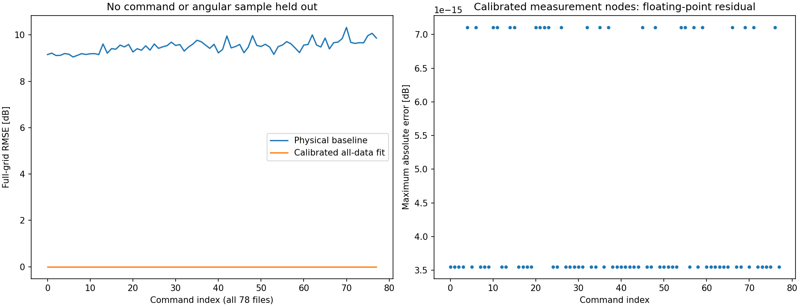
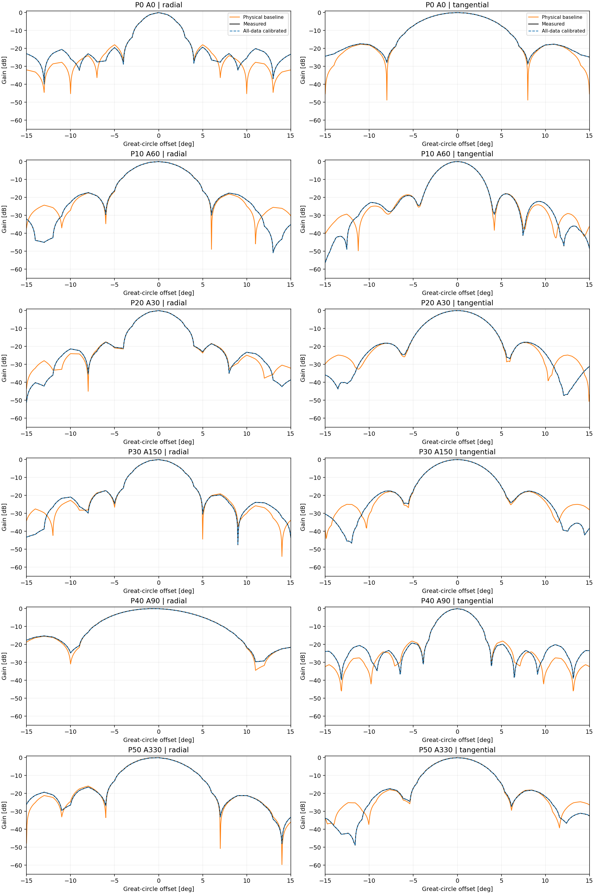
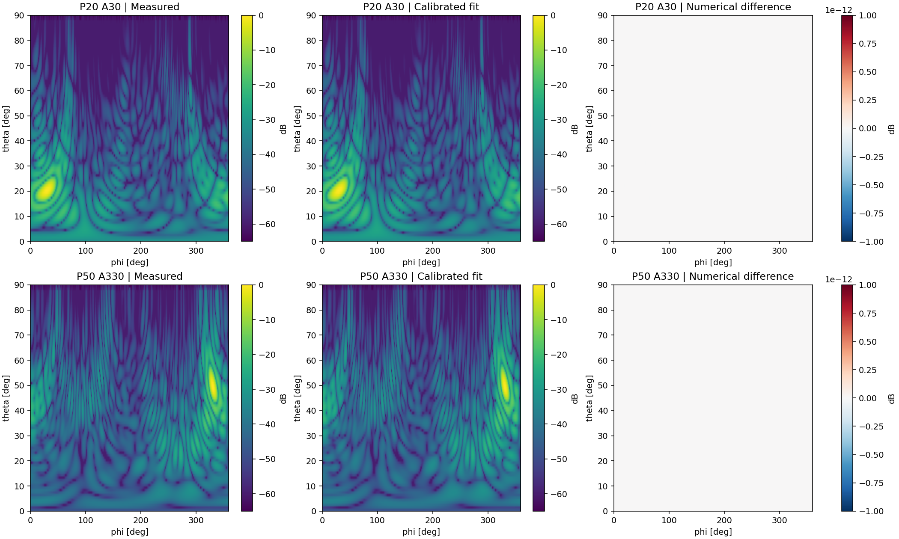

# 全部实测数据拟合：1.97 GHz 波束功率校准

使用本天线运行原示例的 14 波束时域链路，见[全数据拟合天线的时域 OFDM 链路](../time_domain/README.md)。

本版以**所有实测方向图都尽量贴合**为目标，不划分训练/留出数据、不限制残差自由度、不添加平滑或正则化。78 份文件的全部 **2,555,280 个角度采样**均用于拟合，包括 Azimuth=360 别名和 Pitch=0 的重复扫描状态；不同文件可以保留各自的细节。

## 结果

| 检查 | 结果 |
|---|---:|
| 拟合文件数 | 78 / 78 |
| 留出文件数 | 0 |
| 每份方向图网格 | 91×360 |
| 拟合的功率角度采样数 | 2,555,280 |
| 拟合表最大误差 | 7.11×10⁻¹⁵ dB |
| QuaDRiGa 输出 RMSE | 9.43×10⁻¹⁴ dB |
| QuaDRiGa 输出最大误差 | 1.94×10⁻¹¹ dB |
| 验证的极化状态 | LHCP、RHCP 分别验证 |
| QuaDRiGa 功率比对总数 | 5,110,560 |

上述误差覆盖全部原始采样点和旁瓣、零陷区域，没有只统计主瓣，也没有把误差较大的方向舍弃。校准结果与实测的差异已经达到浮点计算精度范围。

## 拟合方法

采用“**502 阵子物理基准 + 每个扫描状态的二维方向图残差**”：

1. 保留 1.97 GHz、椭圆裁剪三角栅格、502 个接收阵子的几何类型和外框，使用全部 78 个扫描状态的 31,413 个高增益采样重新估计间距、旋转、幅度加权和单元方向图参数。此步骤提供物理基准与假设相位。
2. 对每个文件、每个 theta/phi 角度计算独立残差系数。以原始 dB 数据为目标，不重新归一化或改变原始峰值：

   ```text
   residual_db[b,theta,phi] = measured_db[b,theta,phi] - baseline_db[b,theta,phi]
   fitted_db[b,theta,phi]   = baseline_db[b,theta,phi] + residual_db[b,theta,phi]
   ```

   每个测量节点有独立的残差自由度，因此这一最小二乘问题可直接解析求解。在测量节点处不需要迭代优化，也不需要保留非零拟合误差。
3. 物理基准在 −80 dB 设置有限参考值，使实测非零响应能够填补理想阵列零陷。该参考值不是对目标数据的截断；最终输出仍保留原始 −65～0 dB 的数值。
4. 使用校准功率的平方根生成复电场幅度，保留物理基准的假设相位，再构造 QuaDRiGa 的圆极化 `Fa/Fb`。未测后半球填零。

节点之间由 QuaDRiGa 对复电场插值。当前只保证已提供的扫描命令和原始角度网格上的拟合精度；不会将插值误差说成已经有实测验证。

## 使用

```matlab
addpath('/path/to/quadriga_beam_model/experiments/measured_array_1970/all_data_fit');
addpath(genpath('/path/to/QuaDRiGa/quadriga_src'));

% 选择实测扫描命令 Pitch=20、Azimuth=30；默认 RHCP。
[a, meta] = build_allfit_beam1970(20, 30);

% LHCP 使用相同拟合功率，改变理想 Jones 极化状态。
a_lhcp = build_allfit_beam1970(20, 30, 'LHCP');

% 用作上行接收端的已合并波束。
l = qd_layout;
l.simpar.center_frequency = 1.97e9;
l.rx_array = a;
```

`a` 是**合并后的单路等效波束端口**，因此 `a.no_elements=1`；它不表示实际接收天线只有一个阵子。物理接收阵列仍按 502 个阵子建模，收发各约 500 的数量定义没有改变。

校准系数描述扫描状态和观察方向相关的综合功率修正，并不等同于恢复了 502 个真实阵子的方向图或馈电权重。若需要原始阵子级信道，可将本版的 `results/physical_baseline.mat` 传给上一层目录中的 `build_physical_array1970`；该阵子级基准不包含等效波束残差校准。

文件只提供归一化功率，复相位、极化纯度及绝对增益仍不是实测量。默认相位来自物理基准，默认圆极化采用理想 Jones 分量，默认绝对偏移为 0；可通过函数第四个参数设置外部校准的增益偏移。

## 复现

先安装上一级 `requirements.txt` 中的依赖，从本目录运行：

```bash
export OPENBLAS_NUM_THREADS=2
python fit_all_data.py
python plot_allfit.py
```

随后在 MATLAB/Octave 中运行：

```matlab
report = verify_allfit1970('/path/to/QuaDRiGa');
```

验证逐文件读取原始数据，检查两种圆极化状态下 QuaDRiGa 输出的全部原始角度采样，并检查真实 `LOSonly` 上行信道能使用校准波束产生有限非零系数。

## 输出

- `results/physical_baseline.mat`：全扫描状态重新拟合后的 502 阵子基准、78 个命令和接收权重。
- `results/calibration_tables.mat`：全部节点的物理基准、二维残差系数和假设相位。
- `results/fitted_patterns.npz`：78 份完整拟合功率方向图，顺序见 `commands`。
- `results/all_beam_metrics.csv`：每份文件的基准误差、校准误差和源文件 SHA-256；全部标记为 `fit`。
- `results/summary.json`、`python_verification.json`、`quadriga_verification.json`：拟合与检查结果。

此前的物理模型误差与本次校准误差是不同模型的结果。本版达到数值精度的一致，是因为按要求允许每个测量节点进行自由校准，不代表仅用少量阵列参数就唯一恢复了真实天线。

## 对比图






