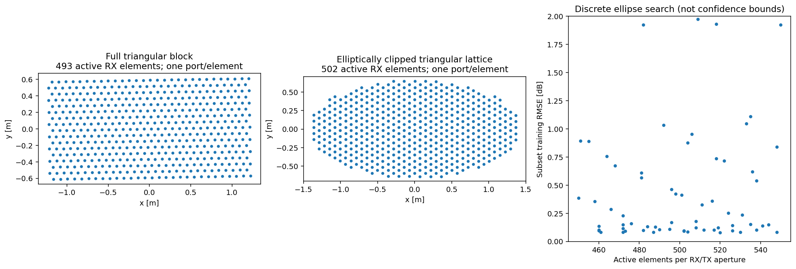
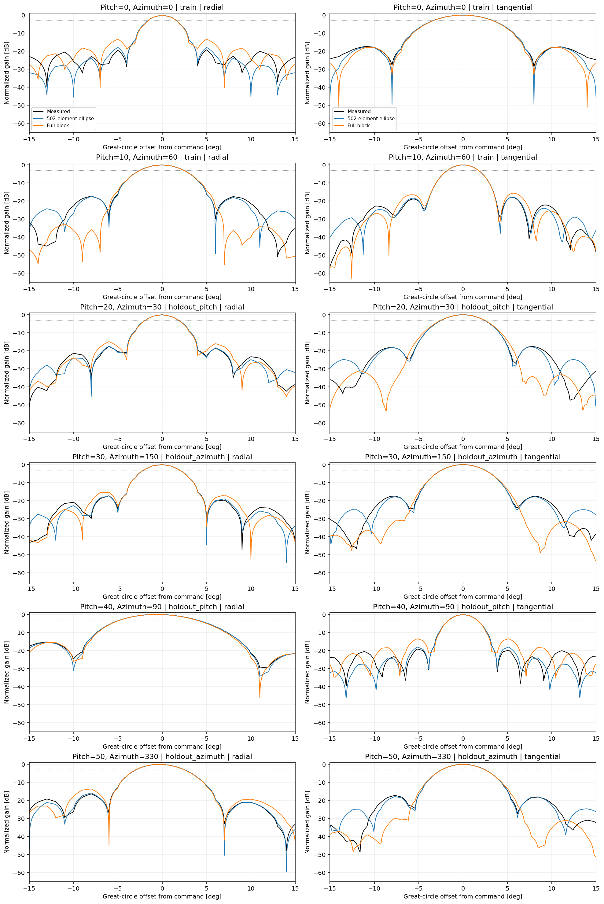
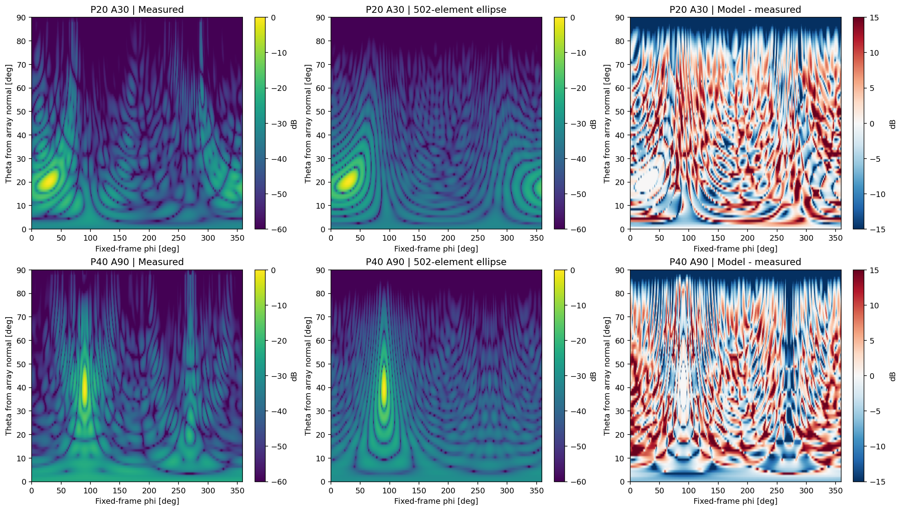
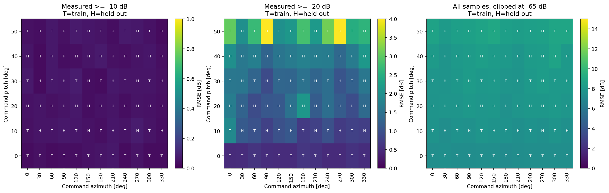
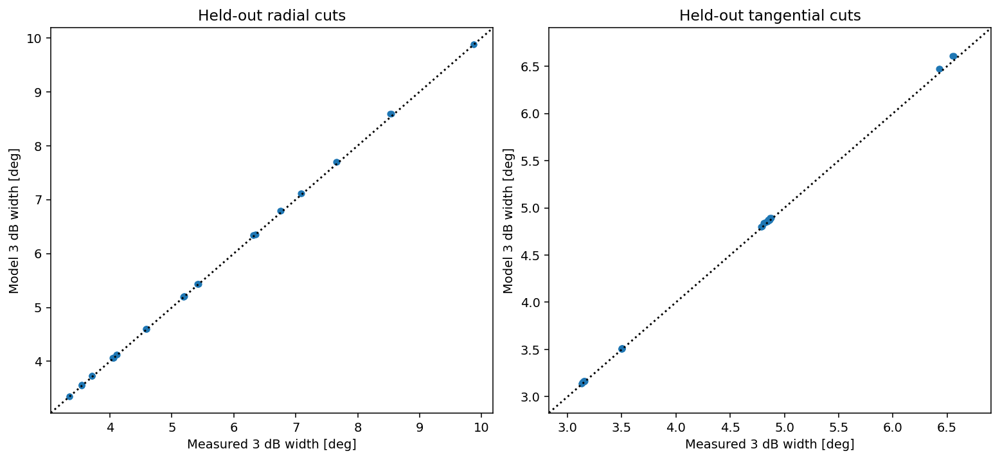
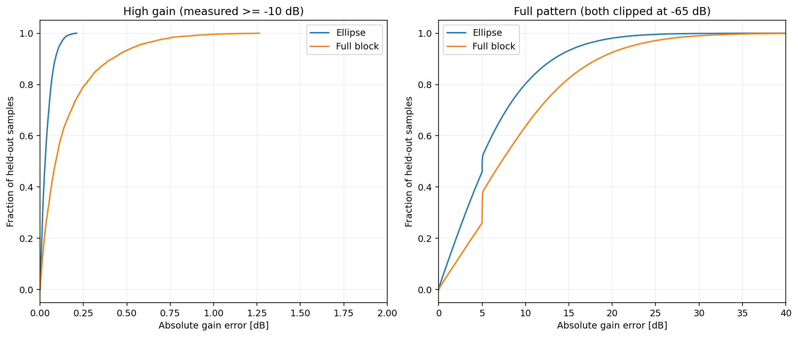

# 1.97 GHz 相控阵建模与实测方向图比较

> 此为前一版物理几何拟合与留出比较报告。后续已按要求采用全部实测数据拟合，最新结果见[全数据拟合报告](../../all_data_fit/README.md)，其校准后功率输出在原始采样网格上与实测一致。

## 结果与适用范围

推荐的物理近似为**椭圆裁剪的三角栅格，共 502 个接收阵子**。候选外框为 41 行×17 列，裁剪后不是 697 个满阵位置；外框两端行无保留点，实际为 39 个非空交错行。阵面内旋转约 −0.0633°，阵子间距约 0.544711λ，即 8.28935 cm。阵面物理尺寸约 2.7283 m×1.2856 m。

按用户澄清，`2×500` 表示发射和接收各约 500 个阵子。本实验的上行接收端只有 502 个独立阵子端口，选择波束后合并成 1 路信号。LHCP/RHCP 作为可选理想极化状态，不将接收阵子数翻倍。发射阵列可另行建立；相同排布是可选假设，没有另一套发射测量可用于验证。

**502 和 41×17 是当前搜索族内的候选，不是对真实硬件排布的确认。** 归一化功率不能唯一恢复阵子坐标、馈电相位、互耦、绝对增益和极化纯度；450～550 的数量范围来自用户先验。主瓣拟合很好，较强旁瓣明显改善，但深旁瓣和零陷仍未完整重现。

## 1. 数据与坐标审计

- 78 份文件均为同一副天线的不同指向命令。文件名 Pitch/Azimuth 是扫描方向；每份文件内的 theta/phi 是观察方向，而不是 78 个阵子的位置。
- 每份文件为 91 个 theta（0～90°）×360 个 phi（0～359°），单位为归一化 dB。全部网格、范围、有限值和 SHA-256 均已记录。
- 固定阵面参考下，实测峰值与文件名指向的平均角度差约 **0.103°**。假定文件内 theta 是围绕每个波束轴线的离轴角，会产生约 **24.897°** 的平均偏差，且 Pitch>0 的峰值不在 theta=0，因此不采用该解释。
- 采用局部坐标：阵面为 x-y 平面，法向为 +z；theta 从 +z 量起，phi 从 +x 向 +y。QuaDRiGa 中 azimuth=phi、elevation=90°−theta。
- 原始 README 中“所有文件 theta=0 都是峰值”的描述与数据不符；原始文件完整保留，模型以数值审计为准。上述坐标仍是由数据一致性推断的约定，缺少测试系统坐标标定记录。
- 6 对 Azimuth=0/360 数据逐数值相同。去掉 360 别名后为 72 个文件命令；Pitch=0 的 12 份是同一几何指向的重复扫描，主瓣相近而旁瓣有差异。实际共有 61 个几何指向。

## 2. 训练和留出

训练文件 30 份：Pitch=0 的 12 份取逐角度中位数，另取 Pitch=10/30/50、Azimuth=0/60/120/180/240/300 的 18 份，构成 **19 个独立训练指向、2610 个拟合角度样本**。拟合区域为训练图归一化增益 ≥−15 dB 的方向，逐指向限制样本数，避免 broadside 重复数据过度加权。

留出文件 42 份：

- Pitch=20/40 的全部 24 份，用于检查未拟合的扫描俯仰角。
- Pitch=10/30/50、Azimuth=30/90/150/210/270/330 的 18 份，用于检查未拟合的方位角。

Azimuth=360 的 6 份只作重复检查，不参加训练或留出平均分。相同几何指向不会跨训练/留出分组。留出文件不参与参数优化或排布排序，但它们仍来自同一次测量；这不是外部独立测量验证。

## 3. 搜索与物理模型

比较了 147 个完整外框三角栅格和 151 个椭圆裁剪三角栅格候选，数量先验为每个方向 450～550 个阵子。椭圆候选先用训练子样本搜索，再对前 12 个候选用全部训练样本精化。矩形阵列也作为诊断对照保留。

完整外框模型最优候选为 17×29=493 个阵子，可拟合主瓣宽度，但旁瓣结构与数据明显不符。训练方向图较接近椭圆口径的旁瓣结构，因此增加椭圆裁剪族；最终几何和连续参数均仅用训练样本确定。

推荐模型的参数如下：

| 参数 | 结果 |
|---|---|
| 载频 | 1.97 GHz |
| 波长 | 0.152179 m |
| 候选栅格外框 | 41×17，椭圆裁剪 |
| 保留阵子/接收端口数 | 502 |
| 三角栅格最近邻间距 | 0.544711λ = 0.0828935 m |
| 相邻行间距 | √3/2 × 最近邻间距 |
| 相邻行横向错位 | 最近邻间距的一半 |
| 阵面内旋转 | −0.063251° |
| 行/列余弦幅度加权系数 | 0.010443 / 约 0 |
| 单元功率方向图 | 前半球 cos(theta)^3.011661 |
| 阵面 x/y 尺寸 | 2.7283 m / 1.2856 m |
| 极化 | 可选理想 LHCP 或 RHCP；未知真实轴比和交叉极化 |
| 绝对增益标度 | 未测得；代码中的单元峰值 0 dBi 仅为假设 |

每个候选共享一套几何、幅度加权和单元方向图，所有命令只改变相位权重，没有逐文件自由拟合。接收权重为单位范数，阵子响应在 QuaDRiGa 中保留真实坐标和几何相位。

不同阵子数、间距、外框、裁剪和加权能形成相近口径；搜索排名不能转换成真实行列数的置信区间，也不能排除不同裁剪边界、非规则排布、有源单元方向图或互耦解释。完整排名和精化候选均保留。

## 4. 与全部留出方向图对比

下表先逐文件计算指标，再对 42 份留出文件平均。theta=0 对应同一个物理极点的 360 个重复样本，不计入角度 RMSE；所有预测均在完整采样前半球归一化，未只在命令方向附近归一化以隐藏栅瓣。

| 指标 | 完整外框三角阵 | 椭圆裁剪三角阵 |
|---|---:|---:|
| 实测 ≥−10 dB 区域 RMSE | 0.2449 dB | **0.0498 dB** |
| 实测 ≥−20 dB 区域 RMSE | 11.6159 dB | **1.6443 dB** |
| 全方向双方截断至−40 dB 的 RMSE | 3.6751 dB | 3.0970 dB |
| 全方向双方截断至−65 dB 的 RMSE | 11.2488 dB | **8.0299 dB** |

≥−20 dB 指标只按实测值选择角度，未把预测值强行截断到 −20 dB，因而不会掩盖模型在实测较强区域预测出深零陷的问题。

椭圆模型在留出数据上的径向/切向 3 dB 宽度平均绝对差为 **0.0189° / 0.0175°**。宽度由原始 1° 网格的功率插值估计，不意味着实际测量分辨率达到这些小数位。实测和模型的峰值落在相同的 1° 观察网格上；不能把浮点数给出的近零角误差当成亚角秒指向精度。

主瓣及较强旁瓣可以近似，但弱旁瓣、零陷与全前半球仍有显著误差。−40 dB 截断或仅统计高增益区域会显著降低指标，因此本报告同时列出 −65 dB 全域结果。拟合模型不等同于完整重建的实测复场。

## 5. QuaDRiGa 与数学验证

已在 GNU Octave 9.4.0 和 QuaDRiGa 2.8.1 上通过：

1. **78 个扫描状态全部导入检查**：对 LHCP/RHCP 两种假设分别检查原始 91×360 网格，功率导入最大误差约 `1.94e-11 dB`。这是保存/导入一致性，不能作为阵列结构预测精度。
2. **502 阵子物理模型检查**：多个指向和观察角上的方向图，与独立阵子复场求和相对误差约 `1.18e-14`；几何投影距离误差约 `1.33e-15 m`。
3. **真实上行接收链路**：QuaDRiGa `LOSonly` 场景中，先生成 502 个接收端口的原始信道，再使用同一参数实现的权重合并到 1 路接收波束。与逐端口合并参考的相对误差为 0。
4. **Python 数学与数据检查**：数据网格、重复别名和训练/留出隔离、阵子间距、几何中心、闭式/直接阵列因子、权重归一化、缓存和解析 Jacobian；Jacobian 有限差分相对误差约 `1.94e-10`。

极化、相位和绝对增益的验证均明确为“未由实测验证”。模型的 LHCP/RHCP Jones 分量采用 QuaDRiGa 约定，但实际测量不含这些分量。`LOSonly` 验证用于接口和合并代数，未验证卫星传播、轨道、馈电误差或互耦。

## 6. 两种可用模型

- `build_physical_array1970`：保留 502 个三角栅格阵子，支持可选 LHCP/RHCP 及任意扫描权重，适合阵子级信道和波束合并。对未提供的扫描角可以按几何生成权重，但本次仅验证给定范围内的留出方向。
- `build_measured_beam1970`：把一个选中的实测扫描状态映射到一个等效天线端口，逐网格保留功率形状，适合使用已有波束的功率方向图。它不推断阵子排布，缺少的相位、极化和绝对标度仍需假设。

两者都只知道测量的前半球，后半球填零仅为计算边界处理，不代表真实后向辐射为零。若要确定真实行列排布、复场和深零陷，需要硬件坐标、绝对/分极化复方向图、馈电幅相、互耦或有源单元方向图，以及独立扫描测量。

## 对比图

