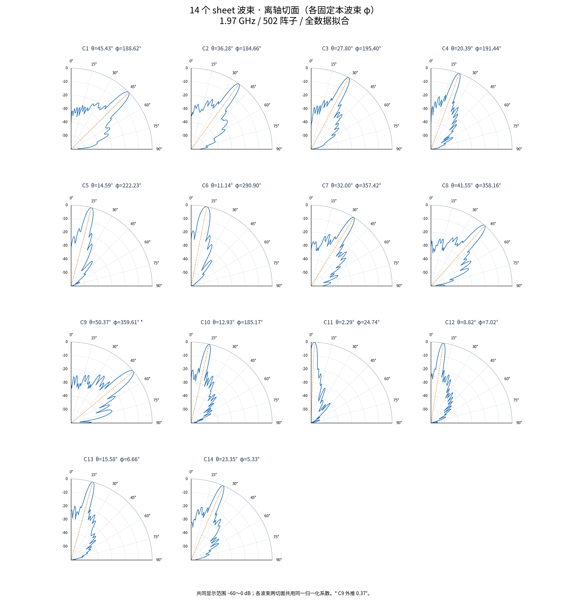
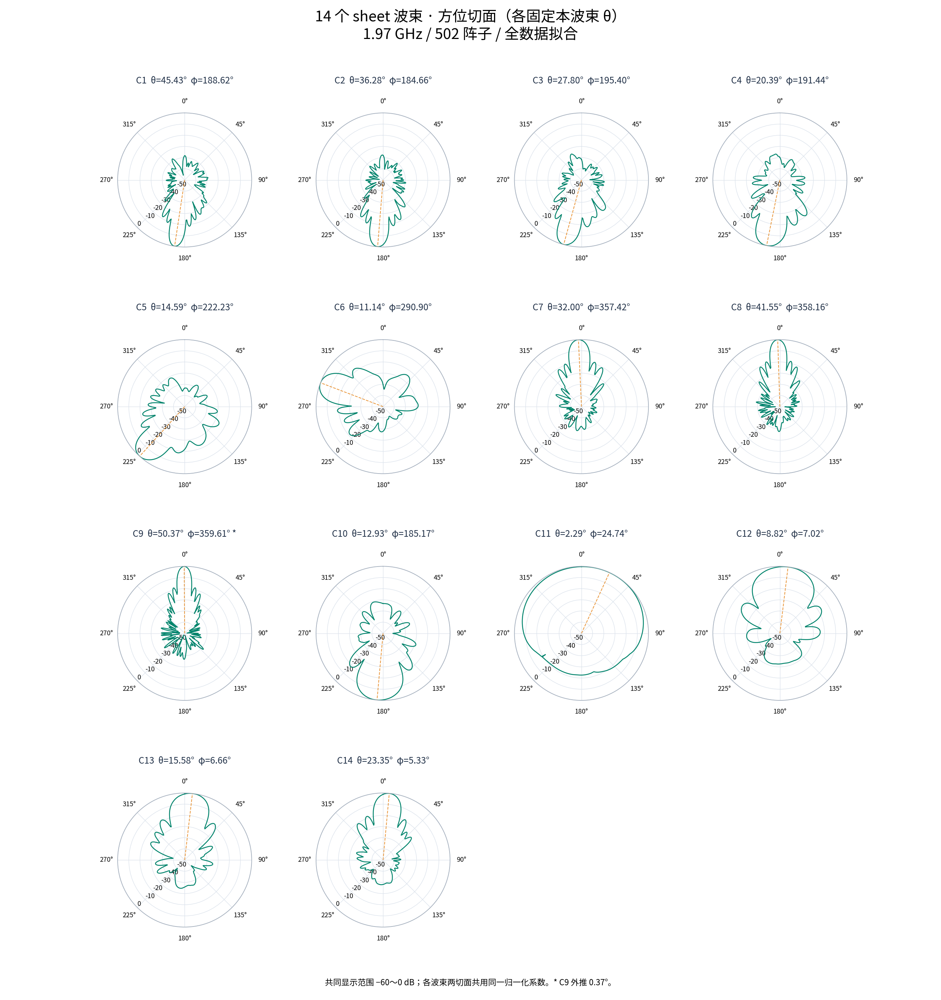

# 14 个 sheet 波束的极坐标方向图

独立绘图模块；读取 `src/beam_codebook/results/beam_model_sheet.mat` 的 14 个角度，以用户确认的 **θ=ele、φ=azi**，调用时域链路相同的 `make_allfit_link_arrays` 生成 1.97 GHz、502 阵子的全数据拟合波束。旧矩形阵缓存中的权重不用于这些方向图。

每个波束绘制两种切面：

- 离轴切面：固定 φ 为该波束 Azimuth，θ 从 0° 到 90°。
- 方位切面：固定 θ 为该波束 Pitch，φ 从 0° 到 360°，末点只用于周期闭合。

曲线功率为 QuaDRiGa 实际复电场插值后的 `|Fa|²+|Fb|²`，与时域链路的天线接口一致；不是从旧矩形阵的 `W` 直接计算，也不是某个原始实测文件的重画。每个波束的两个切面使用同一个采样峰值归一化，避免分别归一化造成相对幅度失真。导出步长 0.25°，并额外包含所有指定指向；更密的绘图点不增加原始 1° 方向图的角分辨率。

外圈 0 dB，显示下限 −60 dB；CSV/MAT 保留未截底的数值。离轴图只画有效的 0～90° 扇区，不补出缺失的背半球。橙色虚线标出目标角。仅 C9 的 50.37° 扫描超出实测范围，使用 50° 边界状态外推 0.37°。其余指向也经过扫描状态插值，复相位和理想圆极化仍为模型假设。

## 生成

从仓库根目录运行，Python 依赖见上一级 `requirements.txt`；中文图示需要 Noto Sans CJK 或微软雅黑/黑体字体：

```bash
octave --quiet --eval "addpath('experiments/measured_array_1970/beam_patterns'); export_sheet_pattern_cuts('/path/to/QuaDRiGa');"
python experiments/measured_array_1970/beam_patterns/plot_sheet_polar.py
```

结果均位于本模块 `results/`：14 张 `C*_polar_cuts.png`、两张总览、14 页 PDF、切面 MAT/CSV 和 `summary.json`。导出时检查方位周期闭合、有限功率和目标指向偏差。




