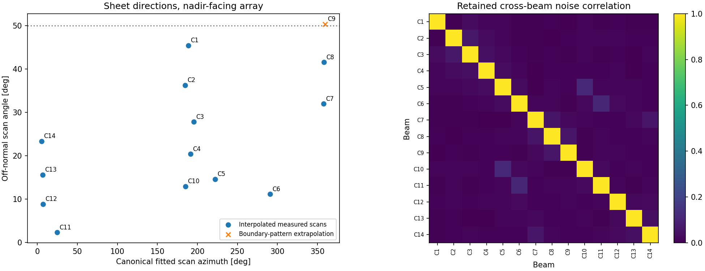

# 全数据拟合天线的时域 OFDM 链路

入口为 `iface_allfit_time_domain.m`。本版本沿用 `src/link_time_domain/README.md` 的波形、用户和功率配置；波束角度改用 `sheet` 表格，天线使用全数据拟合的 **1.97 GHz、502 阵子椭圆裁剪三角栅格和圆极化模型**，并实际使用其方向图校准。

## 运行

先从仓库根目录生成表格角度缓存（不覆盖 photo 缓存）：

```bash
BEAM_ANGLE_SOURCE=sheet octave --quiet --eval "run('src/beam_codebook/run_beam_model.m');"
```

`run_beam_model.m` 默认仍为 `photo`；环境变量只能取 `photo` 或 `sheet`。仓库已提供生成的 `src/beam_codebook/results/beam_model_sheet.mat` 和配套 CSV。该缓存中的旧矩形阵列结果只供原生成器参考，当前时域脚本**仅取角度与波束名称**，实际载频、502 阵子位置和合并权重均由全数据拟合模型产生。

```matlab
addpath('/path/to/quadriga_beam_model/experiments/measured_array_1970/time_domain');
r = iface_allfit_time_domain(struct( ...
    'qd_path','/path/to/QuaDRiGa', ...
    'output_file','/tmp/iface_allfit_time_domain_out.mat'));
```

支持原示例参数 `qd_path`、`nSlot`、`nSym`、`nFFT`、`fd_half`、`seed`、`output_file`；增加 `polarization`（默认 `RHCP`，可选 `LHCP`）和 `gain_offset_dbi`（默认 0）。原始方向图是归一化功率，默认 0 dBi 峰值标度沿用全数据拟合模型的假设；若有绝对增益标定，可通过 `gain_offset_dbi` 设置。

本云环境的完整默认验证命令：

```bash
/workspace/.cloud-setup/bin/octave --quiet --eval "addpath('/workspace/quadriga_beam_model/experiments/measured_array_1970/time_domain'); verify_allfit_time_domain('/workspace/.cloud-setup/deps/QuaDRiGa','/tmp/iface_allfit_default.mat');"
```

所有验证和数据文件路径都由脚本自身位置解析，不依赖当前工作目录。波形默认输出到本模块 `results/iface_allfit_time_domain_out.mat`；也可指定 `output_file` 或设为空字符串关闭保存。QuaDRiGa 可通过 `opts.qd_path` 或环境变量 `QD_PATH` 加入路径。

## 参数来源

| 类别 | 参数 |
|---|---|
| 全数据拟合天线 | 1.97 GHz、41×17 外框裁剪后 502 个接收阵子、三角栅格、拟合间距/旋转/幅度加权、圆极化与逐扫描状态校准 |
| 表格角度波束 | `beam_model_sheet.mat` 中的 14 个 `ele_tab`、`azi_tab`，不读取其中旧载频、旧几何或旧 `W` |
| 用户与场景 | 基站 25 m、用户 1.5 m；水平距离 23.5*tand(ele)，其中 ele 为离轴 Pitch；`3GPP_38.901_UMi_NLOS`；每个波束方向 1 个单天线 omni 用户 |
| OFDM | 288 个有效子载波、120 kHz 间隔、FFT=512、DC 留空、采样率 61.44 MHz |
| 运行长度 | 默认 4 个时隙，每时隙 14 个 OFDM 符号 |
| 信道离散化 | 33 抽头加窗 sinc 小数时延核、公共因果延迟 16 个采样、每用户理想定时提前、CP 自动覆盖 FIR 尾部 |
| 信号与噪声 | QPSK；23 dBm/3168 个子载波的功率谱密度；290 K、7 dB NF；单位酉 IFFT/FFT；随机种子 1 |
| 接收机 | 逐采样波束合并，去 CP、FFT、理想 CSI 标量 MMSE、硬判决和 BER |

## 坐标与 14 个 sheet 指向

附件[波束方向图数据说明](../../../data/measured_patterns/beam_pattern_data_notes.md)确认方向图 θ 从固定阵面法线起算，φ 绕该轴，θ 只覆盖前半球 0～90°；文件名 Pitch/Azimuth 是扫描状态，不是每个波束自身坐标系。本项目保持原始数据，包括钳位区，符合此前全数据拟合的要求；附件中关于数据来源和权值的推断不作为已确认硬件参数。

用户已确认：`sheet` 的 `ele_tab` **直接表示相对固定阵面法线的离轴 Pitch**，`azi_tab` 直接表示该固定坐标系中的扫描 Azimuth。因此使用 **θ = ele、φ = mod(azi,360)**，不做 `90-ele` 换算，也不把 φ 当作波束自身坐标。两组数值保持用户给出的 14 组表格数据。

拟合天线局部 x-y 平面、法向 +z。为把所有前半球目标放置到低于基站的用户平面，本示例采用对地安装姿态，将局部法向 +z 转为世界 −z。安装姿态是链路坐标约定，不是数据识别的硬件姿态。采用绕 x 轴 180° 的刚体旋转：

```text
u_canonical = [sin(ele)*cos(azi); sin(ele)*sin(azi); cos(ele)]
R = diag([1 -1 -1])
p_world = R * p_canonical
u_world = R * u_canonical
measured_theta = ele
measured_phi = mod(azi, 360)
```

QuaDRiGa 基站 track orientation 为 `[pi;0;0]`（bank=180°），与此旋转一致；验证通过 QuaDRiGa 自身角度转换检查该姿态。世界方位角为 `mod(-azi,360)`，世界仰角为 `ele-90`，与局部扫描角不同，不能混用。

用户位置由波束世界射线与 z=1.5 m 平面的交点确定：`rx = [0;0;25] + u_world * (23.5/cos(ele))`，因此水平距离为 `23.5*tan(ele)`。这是把 ele 改为离轴角后所需的几何修正；原来的 `23.5/tan(ele)` 仅适用于水平面下倾角定义。基站高度、用户高度、传播场景和波形参数保持原配置。`result.ue_positions` 保存实际位置，验证逐用户检查视线方向与波束指向一致。

原波束不是文件名中 10°/30° 步进的扫描命令，因此需要扫描状态插值：

1. 在拟合坐标中计算目标扫描 theta/phi。
2. 选择相邻的实测 Pitch/Azimuth 扫描状态。
3. 将每个相邻状态的完整功率图按最小三维旋转重定向到目标指向，再按扫描位置在线性功率域加权。
4. 采用 502 阵子基准在目标方向的几何相位，构造圆极化复电场；角度观测值在原始网格之间同样按功率插值。

**13 个波束的 θ 位于实测扫描 0～50° 范围内，仅 C9 的 50.37° 超出 0.37°。** C9 使用 50° 边界扫描状态的方向图重定向至 50.37°，不钳位目标；该 0.37° 属于外推。其余 13 个波束在实测扫描状态之间插值，不能声称任意表格指向都已直接测量。观察角覆盖到 90° 不代表已测过 90° 的波束扫描状态。

重定向保持边界方向图的角宽度，没有额外推断高扫描角下的口径投影、扫描损失或极化劣化。`results/beam_metrics.csv` 逐波束记录 sheet 局部 Pitch/Azimuth、拟合角度、插值/外推标志和实际峰值偏差。

## 在时域接入全数据校准

全数据拟合版本校准的是**合并后的波束响应**，并未测得 502 个阵子的独立校准方向图。因此，不能把校准后的波束响应再乘一次 `Wq'`，也不能仅载入其几何而忽略方向图残差。

本版本先用同一个 QuaDRiGa builder 生成公共的散射/相位参数，再分别获得：

- `h_ant{u}`：用户 u 到 502 个原始阵子端口的离散 FIR。
- `h_beam_cal{u}`：用户 u 到 14 路校准波束输出的离散 FIR。

两者使用共同的每用户时延参考、采样率、小数时延核和长度。定义：

```text
h_delta{u} = h_beam_cal{u} - Wq' * h_ant{u}

r_ant[n] = sum_u (h_ant{u} * x_u)[n] + noise_ant[n]
y[n]     = Wq' * r_ant[n] + sum_u (h_delta{u} * x_u)[n]
```

这里 `*` 表示时域线性卷积。于是信号部分严格等于校准波束 FIR 的时域传播，但过程仍保留 502 路天线采样和逐采样 `Wq'` 合并。残差校准也通过时域 FIR 完成，不使用频域信道乘法来运输发送波形。

接收端 FFT 得到的 `Heff` 已是校准/合并后的 CSI，均衡前不会重复做波束合并。FFT 只用于 OFDM 调制解调和接收机参考计算。

噪声沿用原示例：在 502 个天线端口加入独立复高斯噪声，再用单位范数 `Wq` 合并，保留 `N0*(Wq'*Wq)` 的跨波束噪声相关性。时域校准残差只作用于信号通道，未将未知的实测接收机噪声特性一并识别。绝对增益、复相位与极化纯度依然不是实测量，BER 是这些明确假设下的仿真结果。

## 验证和结果

```matlab
% 运行完整的默认 4×14 符号链路，并保存验证摘要、CSV 和接收机参考。
report = verify_allfit_time_domain('/path/to/QuaDRiGa','/tmp/default_waveform.mat');
```

验证内容包括原实测扫描节点的功率保持、坐标和极化约定、全部 14 个 sheet 指向、完整默认波形配置、跨时隙滤波连续性、天线传播加时域残差与校准 FIR 的等价性、无噪声时频参考、权重归一化和相关噪声模型。

详细数值见 `results/validation.json`，逐用户 BER、预测 BER、SINR、比特计数和外推标志见 `results/beam_metrics.csv`。默认每用户传输 **32,256 比特**。`receiver_reference.mat` 保存 `Heff`、SINR、BER、权重和噪声协方差；较大的逐阵子 FIR 与最后时隙波形通过用户指定的 `output_file` 保存，不重复放入仓库。

本次完整默认运行通过的数值检查：

| 检查 | 结果 |
|---|---:|
| 自适应 CP | 342 个采样 |
| 502 阵子合并加时域残差，与直接校准 FIR 的相对误差 | 1.73×10⁻¹⁴ |
| 无噪声 OFDM 时域链路与频域 CSI 参考的相对误差 | 1.48×10⁻¹⁴ |
| 实测扫描节点经扫描插值接口后的最大功率误差 | 7.46×10⁻¹¹ dB |
| 14 个输出波束的最大采样峰值指向偏差 | 0.6153° |
| 8192 个噪声样本的协方差相对误差 | 0.04319 |

峰值偏差包含原始 1° 数据采样、原始测量峰值偏移和扫描插值/外推的影响；没有把有限网格上的峰值误差解释为连续角度精度。BER 预测仍使用原示例的高斯干扰近似，不要求它与有限用户 QPSK 干扰的实测 BER 完全相等。

运行 `python plot_link_result.py` 可从验证结果重新生成下图（使用上一级 `requirements.txt` 的 Python 依赖）：



