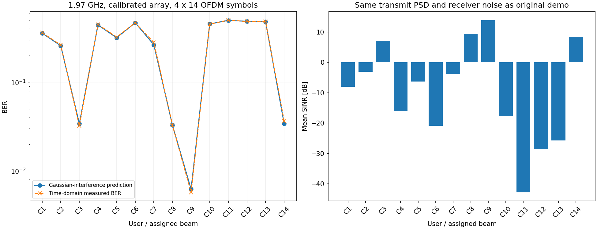

# 全数据拟合天线的时域 OFDM 链路

入口为 `iface_allfit_time_domain.m`。本版本沿用 `src/beam_model_photo/iface_demo_time_domain.md` 的波形、用户、功率和波束方向配置，将天线换成全数据拟合的 **1.97 GHz、502 阵子椭圆裁剪三角栅格和圆极化模型**，并实际使用其方向图校准。

## 运行

```matlab
addpath('/path/to/quadriga_beam_model/experiments/measured_array_1970/time_domain');
r = iface_allfit_time_domain(struct( ...
    'qd_path','/path/to/QuaDRiGa', ...
    'output_file','/tmp/iface_allfit_time_domain_out.mat'));
```

支持原示例参数 `qd_path`、`nSlot`、`nSym`、`nFFT`、`fd_half`、`seed`、`output_file`；增加 `polarization`（默认 `RHCP`，可选 `LHCP`）和 `gain_offset_dbi`（默认 0）。原始方向图是归一化功率，默认 0 dBi 峰值标度沿用全数据拟合模型的假设；若有绝对增益标定，可通过 `gain_offset_dbi` 设置。

本云环境的完整默认验证命令：

```bash
/workspace/.cloud-setup/bin/octave --quiet --eval "addpath('/workspace/quadriga_beam_model/experiments/measured_array_1970/time_domain'); verify_allfit_time_domain('/workspace/.cloud-setup/deps/QuaDRiGa','/tmp/iface_allfit_default.mat');"
```

所有验证和数据文件路径都由脚本自身位置解析，除指定的波形输出文件外不依赖当前工作目录。QuaDRiGa 可通过 `opts.qd_path` 或环境变量 `QD_PATH` 加入路径。

## 参数来源

| 类别 | 参数 |
|---|---|
| 全数据拟合天线 | 1.97 GHz、41×17 外框裁剪后 502 个接收阵子、三角栅格、拟合间距/旋转/幅度加权、圆极化与逐扫描状态校准 |
| 原时域示例的波束 | `beam_model_photo.mat` 中的 14 个 `ele_tab`、`azi_tab`，不读取其中旧载频、旧几何或旧 `W` |
| 用户与场景 | 基站 25 m、用户 1.5 m；水平距离 23.5/tand(ele)；`3GPP_38.901_UMi_NLOS`；每个波束方向 1 个单天线 omni 用户 |
| OFDM | 288 个有效子载波、120 kHz 间隔、FFT=512、DC 留空、采样率 61.44 MHz |
| 运行长度 | 默认 4 个时隙，每时隙 14 个 OFDM 符号 |
| 信道离散化 | 33 抽头加窗 sinc 小数时延核、公共因果延迟 16 个采样、每用户理想定时提前、CP 自动覆盖 FIR 尾部 |
| 信号与噪声 | QPSK；23 dBm/3168 个子载波的功率谱密度；290 K、7 dB NF；单位酉 IFFT/FFT；随机种子 1 |
| 接收机 | 逐采样波束合并，去 CP、FFT、理想 CSI 标量 MMSE、硬判决和 BER |

## 坐标与 14 个原指向

拟合天线在局部 x-y 平面，法向为 +z；原示例阵面法向为世界 +x，长边沿竖直方向。采用刚体旋转：

```text
R = [0 0 1; 0 1 0; -1 0 0]
p_world = R * p_canonical
u_world = [cos(ele)*cos(azi); cos(ele)*sin(azi); -sin(ele)]
u_canonical = R' * u_world
```

QuaDRiGa 基站 track 的 orientation 为 `[0;-pi/2;0]`，与此旋转一致。位置、波束权重和校准方向图均在同一套坐标变换下使用。

原波束不是文件名中 10°/30° 步进的扫描命令，因此需要扫描状态插值：

1. 在拟合坐标中计算目标扫描 theta/phi。
2. 选择相邻的实测 Pitch/Azimuth 扫描状态。
3. 将每个相邻状态的完整功率图按最小三维旋转重定向到目标指向，再按扫描位置在线性功率域加权。
4. 采用 502 阵子基准在目标方向的几何相位，构造圆极化复电场；角度观测值在原始网格之间同样按功率插值。

**C1、C2、C8、C9 的目标扫描 theta 分别约为 64.48°、54.74°、59.10°、67.45°，超出实测 0～50°。** 它们采用 50° 边界测量状态的方向图重定向，保持原目标方向，不将其钳位成 50°；此为外推假设，不能声称这些目标方向已经有实测验证。其余 10 个波束也采用扫描插值，而不是已有文件的精确扫描状态。

重定向保持边界方向图的角宽度，没有额外推断高扫描角下的口径投影、扫描损失或极化劣化。`results/beam_metrics.csv` 逐波束记录世界角度、拟合角度、插值/外推标志和实际峰值偏差。

## 在时域接入全数据校准

全数据拟合版本校准的是**合并后的波束响应**，并未测得 502 个阵子的独立校准方向图。因此，不能把校准后的波束响应再乘一次 `Wq'`，也不能仅载入其几何而忽略方向图残差。

本版本先用同一个 QuaDRiGa builder 生成公共的散射/相位参数，再分别获得：

- `h_ant{u}`：用户 u 到 502 个原始阵子端口的离散 FIR。
- `h_beam_cal{u}`：用户 u 到 14 路校准波束输出的离散 FIR。

两者使用共同的每用户时延参考、采样率、小数时延核和长度。定义：

```text
h_delta{u} = h_beam_cal{u} - Wq' * h_ant{u}

r_ant[n] = sum_u (h_ant{u} * x_u)[n] + noise_ant[n]
y[n]     = Wq' * r_ant[n] + sum_u (h_delta{u} * x_u)[n]
```

这里 `*` 表示时域线性卷积。于是信号部分严格等于校准波束 FIR 的时域传播，但过程仍保留 502 路天线采样和逐采样 `Wq'` 合并。残差校准也通过时域 FIR 完成，不使用频域信道乘法来运输发送波形。

接收端 FFT 得到的 `Heff` 已是校准/合并后的 CSI，均衡前不会重复做波束合并。FFT 只用于 OFDM 调制解调和接收机参考计算。

噪声沿用原示例：在 502 个天线端口加入独立复高斯噪声，再用单位范数 `Wq` 合并，保留 `N0*(Wq'*Wq)` 的跨波束噪声相关性。时域校准残差只作用于信号通道，未将未知的实测接收机噪声特性一并识别。绝对增益、复相位与极化纯度依然不是实测量，BER 是这些明确假设下的仿真结果。

## 验证和结果

```matlab
% 运行完整的默认 4×14 符号链路，并保存验证摘要、CSV 和接收机参考。
report = verify_allfit_time_domain('/path/to/QuaDRiGa','/tmp/default_waveform.mat');
```

验证内容包括原实测扫描节点的功率保持、坐标和极化约定、全部 14 个原指向、完整默认波形配置、跨时隙滤波连续性、天线传播加时域残差与校准 FIR 的等价性、无噪声时频参考、权重归一化和相关噪声模型。

详细数值见 `results/validation.json`，逐用户 BER、预测 BER、SINR、比特计数和外推标志见 `results/beam_metrics.csv`。默认每用户传输 **32,256 比特**。`receiver_reference.mat` 保存 `Heff`、SINR、BER、权重和噪声协方差；较大的逐阵子 FIR 与最后时隙波形通过用户指定的 `output_file` 保存，不重复放入仓库。

本次完整默认运行通过的数值检查：

| 检查 | 结果 |
|---|---:|
| 自适应 CP | 352 个采样 |
| 502 阵子合并加时域残差，与直接校准 FIR 的相对误差 | 1.11×10⁻¹⁴ |
| 无噪声 OFDM 时域链路与频域 CSI 参考的相对误差 | 9.64×10⁻¹⁵ |
| 实测扫描节点经扫描插值接口后的最大功率误差 | 7.65×10⁻¹¹ dB |
| 14 个输出波束的最大采样峰值指向偏差 | 1.1441° |
| 8192 个噪声样本的协方差相对误差 | 0.04193 |

峰值偏差包含原始 1° 数据采样、原始测量峰值偏移和扫描插值/外推的影响；没有把有限网格上的峰值误差解释为连续角度精度。BER 预测仍使用原示例的高斯干扰近似，不要求它与有限用户 QPSK 干扰的实测 BER 完全相等。

运行 `python plot_link_result.py` 可从验证结果重新生成下图（使用上一级 `requirements.txt` 的 Python 依赖）：




